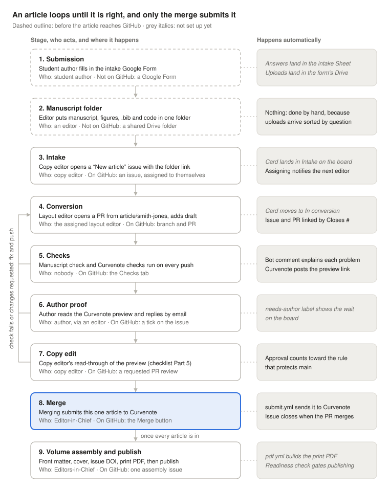

# Morganton Scientific — Volume 4 (2026–2027)

Student research from the North Carolina School of Science and Mathematics, Morganton.
Published at <https://morgantonscientific.ncssm.edu>.

**Start here:** [`docs/volume-4-workflow.md`](docs/volume-4-workflow.md) — how a volume gets made,
from intake through publication, written at the end of Volume 3.

## How an article gets published

Two steps happen before an article reaches GitHub; the rest happen on the article's issue and
pull request. Only the merge has consequences: it submits the article to Curvenote. A failed check
or a requested change sends the article back to the layout editor, on the same pull request.

<!-- Drawn by scripts/workflow_diagram.py. To change it, edit the list of stages at the top of
     that script and run `python3 scripts/workflow_diagram.py`; don't edit the SVGs by hand. -->
<picture>
  <source media="(prefers-color-scheme: dark)" srcset="docs/images/workflow-dark.svg">
  
</picture>

The [Volume 4 workflow](docs/volume-4-workflow.md) explains each step, and the role guides below
say how to do them.

## Layout

```
papers/<lastname>/     one article: article.md, myst.yml, refs.bib, images/
essays/<lastname>/     same shape
papers/_template/      copy this to start a new article
frontmatter/           foreword and editors' note
dividers/              the section pages in the print PDF
templates/             typst templates for the print edition
scripts/               make_pdfs.sh and friends
docs/                  role guides and the workflow plan
morganton2027.yml      shared config; every article extends it
```

## Guides

| | For |
|---|---|
| [Author's Guide](docs/author-guide.md) | Students — what to supply and why. No markup required |
| [Copy Editor's Checklist](docs/copy-editor-checklist.md) | Content review and house style |
| [Layout Editor's Guide](docs/layout-editor-guide.md) | MyST conversion, and the most common mistakes |
| [Volume 4 workflow](docs/volume-4-workflow.md) | How the whole thing runs this year |
| [Reference](docs/reference.md) | Identifiers, issue DOIs, editors, and non-obvious behavior |

## Adding an article

```bash
cp -R papers/_template papers/<lastname>
```

Fill in the `CHANGEME`s, open a PR, apply the **`draft`** label to get a Curvenote preview, and
merge when the checks pass. Merging submits it; nothing is published until
`publish_dispatch.yml` is run manually.

## Workflows

| | Trigger | Effect |
|---|---|---|
| `lint.yml` | every PR | The manuscript check (`scripts/check_article.py`) on changed articles; results posted on the PR |
| `draft.yml` | PR labeled `draft` | Preview and checks. Submits nothing |
| `submit.yml` | push to `main` | Submits changed articles as new versions |
| `resubmit_dispatch.yml` | manual | Submits **all** articles — use after changing `frontmatter/` or shared config |
| `publish_dispatch.yml` | manual | Submits all, then **publishes**. Irreversible |

## Building the print PDF

```bash
brew install typst pdftk-java
brew install --cask font-noto-sans font-noto-serif
npm install -g mystmd
cd scripts && bash ./make_pdfs.sh
```

The Noto fonts are required. Without them typst substitutes silently and the page numbers come out
wrong with no error. The issue DOI must also be set in `frontmatter/volume.yml`; the cover template
requires it.

## Previous volumes

[2026 (Volume 3)](https://github.com/ncssm/morgantonscientific2026) ·
[2025 (Volume 2)](https://github.com/ncssm/morgantonscientific2025) ·
[website](https://github.com/ncssm/morsci-website)
